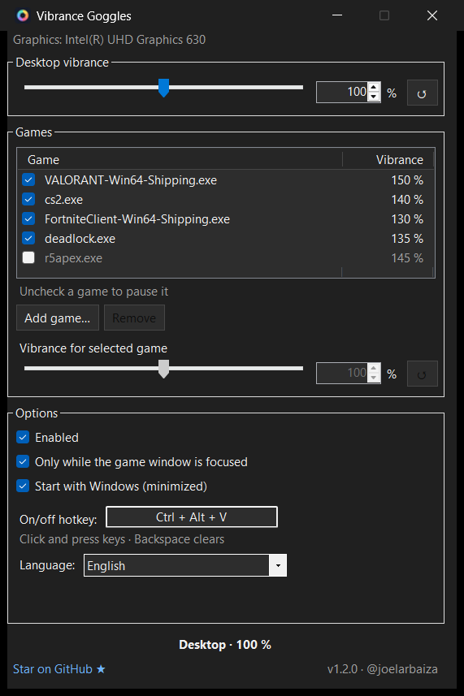
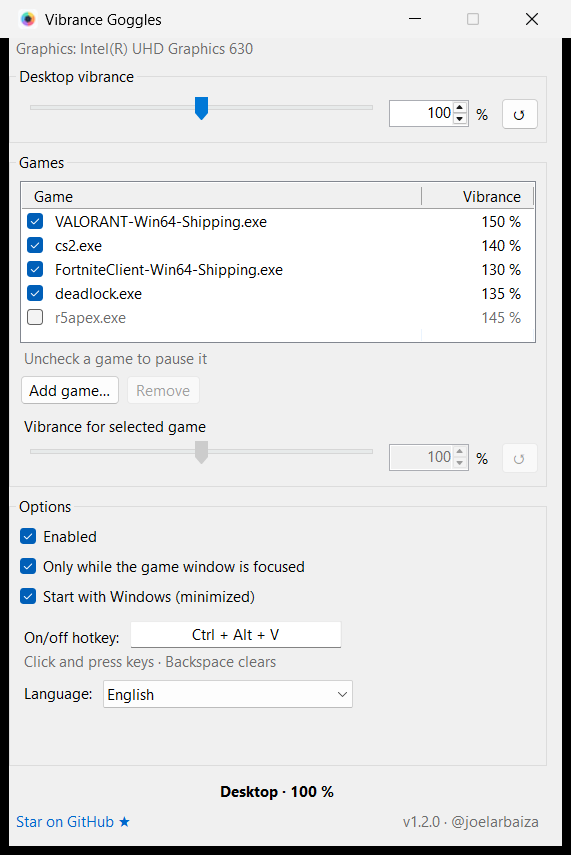

<div align="center">


# Vibrance Goggles

**Digital vibrance for Intel and AMD integrated graphics.**
Boost color saturation automatically when your game is in focus, and go back to normal colors on the desktop.

Windows 10 · Windows 11 · Intel HD / UHD / Iris · AMD Radeon (Vega, RDNA)

[**Download the latest release**](https://github.com/joelarbaiza/vibrance-goggles/releases/latest) · [Español](#español)

<table>
  <tr>
    <th>Dark mode</th>
    <th>Light mode</th>
  </tr>
  <tr>
    <td></td>
    <td></td>
  </tr>
</table>

<sub>The app follows your Windows theme automatically.</sub>

</div>

---

NVIDIA has "Digital Vibrance" and tools like VibranceGUI, but laptops and PCs running on **integrated graphics** have no easy way to get the same punchy colors that make enemies stand out in **Valorant, CS2, Fortnite, Deadlock, Apex Legends, Marvel Rivals** and other competitive shooters.

Vibrance Goggles fills that gap:

- 🎮 **Per-game saturation**: give each game its own level (e.g. Valorant 150 %, Deadlock 130 %).
- 🖥️ **Normal colors on the desktop**: it switches back as soon as you alt-tab.
- ✅ **Pause a game without removing it**: just uncheck it in the list.
- ↺ **One-click reset** to normal colors (100 %) on every slider.
- 🌙 **Dark mode** that follows Windows automatically, even while the app is open. The window and tray icon switch between a dark and a light variant too.
- ⌨️ **Custom hotkey**: toggle vibrance on and off from inside the game (default `Ctrl + Alt + V`).
- 🚀 **Start with Windows**, minimized to the tray.
- 🧩 **No manual DLL copying**: the Intel interface is generated from your installed driver at startup.
- 🔓 **No admin rights** and no background service. Installer (`.msi`) or portable `.exe`.
- 🌐 13 languages: English, Español, Português, Français, Deutsch, Italiano, Русский, Українська, Polski, Türkçe, 简体中文, 日本語, 한국어. Follows your Windows language or pick one in Options.
- ♻️ Imports your game list from Color-Goggles on first run.

## Is it safe for anti-cheat?

Vibrance Goggles never touches the game process. It only changes the display color settings in the graphics driver, the same ones the Intel Graphics Command Center or AMD Software change. It does not inject, hook, or read game memory.

## Install

1. Download **`VibranceGoggles-x.y.z.msi`** from [Releases](https://github.com/joelarbaiza/vibrance-goggles/releases/latest) and run it. It installs for your user only (no admin prompt), adds a Start menu shortcut and opens the app.
   Prefer no installer? Download `VibranceGoggles-x.y.z-portable.zip`, extract it anywhere and run `VibranceGoggles.exe`.
2. Click **Add game…**, pick your game from the list of open programs (or type its `.exe` name) and set its vibrance.

Uninstall from *Settings → Apps → Installed apps → Vibrance Goggles*.

Requirements: Windows 10 (1903 or newer) or Windows 11, 64-bit, and the official Intel or AMD graphics driver. .NET Framework 4.8 is already part of Windows.

### "Windows protected your PC"

The first time you run the installer, Microsoft Defender SmartScreen may show **"Windows protected your PC"**. This appears for new apps that are not code-signed yet and have few downloads. It does not mean a virus was found.

1. Click **More info**.
2. Click **Run anyway**.

You only need to do this once. If you prefer to check the file first, the source code and the build that produced each release are public: every `.msi` and `.zip` is built by [GitHub Actions](https://github.com/joelarbaiza/vibrance-goggles/actions) from this repository. Code signing is in progress (see [Code signing policy](#code-signing-policy)).

## Supported graphics

| Vendor | Graphics | How | Status |
|---|---|---|---|
| Intel | HD, UHD, Iris, Iris Xe (6th gen and newer) | Intel DataHandler COM interface (`igfxDH.dll`) | ✅ Tested on UHD 630 |
| AMD | Radeon integrated (Vega, RDNA) and discrete | AMD Display Library (`atiadlxx.dll`) | 🧪 Implemented from the ADL SDK, needs testers |
| NVIDIA | — | Use NVIDIA Control Panel → *Digital Vibrance* | Not planned for now |

On hybrid laptops (Intel + NVIDIA, Optimus), the built-in screen is usually driven by the Intel GPU, so Vibrance Goggles works there.

If no supported graphics are found, the window says so and details are written to `%APPDATA%\VibranceGoggles\log.txt`. Please [open an issue](https://github.com/joelarbaiza/vibrance-goggles/issues) with that file.

## Vibrance scale

`100 %` = normal colors · `0 %` = grayscale · `200 %` = double saturation (the maximum the drivers accept).

## Build from source

```powershell
git clone https://github.com/joelarbaiza/vibrance-goggles
cd vibrance-goggles
dotnet build src/VibranceGoggles/VibranceGoggles.csproj -c Release
dotnet build installer -c Release -p:ProductVersion=1.0.0   # optional: the .msi (WiX Toolset 5)
```

Releases are built by GitHub Actions: pushing a tag `vX.Y.Z` publishes the `.msi` and the portable `.zip`.

Needs the .NET SDK (any recent version). The output targets .NET Framework 4.8, so it runs on any Windows 10/11 machine without installing a runtime.

Settings live in `%APPDATA%\VibranceGoggles\settings.xml`.

## Code signing policy

Releases are built only by [GitHub Actions](.github/workflows/build.yml) from the source code in this repository. Code signing through the [SignPath Foundation](https://signpath.org) open source program has been requested; until it is approved, releases are not signed.

- Committers and reviewers: [@joelarbaiza](https://github.com/joelarbaiza)
- Approvers: [@joelarbaiza](https://github.com/joelarbaiza)

Changes proposed by people who are not committers (pull requests) are reviewed before they are merged, and every signed release is approved manually.

### Privacy policy

This program will not transfer any information to other networked systems unless specifically requested by the user or the person installing or operating it. It has no telemetry and no update checks; the only link it opens is the GitHub page, and only when you click it. Settings are stored locally in `%APPDATA%\VibranceGoggles`.

## Credits

Inspired by [Color-Goggles](https://github.com/daniele-salvagni/color-goggles) by Daniele Salvagni, which first showed that the Intel driver could do this. Vibrance Goggles is an independent rewrite and shares no code with it.

## License

[MIT](LICENSE)

---

## Español

**Saturación (digital vibrance) para gráficas integradas Intel y AMD.** Sube los colores automáticamente cuando el juego está en primer plano y los devuelve a la normalidad en el escritorio.

- Saturación distinta para cada juego.
- Atajo de teclado personalizable para activarla o desactivarla dentro del juego.
- Se inicia con Windows, minimizado en la bandeja.
- Sin copiar DLLs a mano y sin permisos de administrador.
- La ventana siempre se abre centrada.
- Activa o desactiva cada juego con su casilla, sin quitarlo de la lista.
- Botón ↺ para volver al 100% en cada barra.
- Modo oscuro automático, igual que Windows; el icono de la ventana y de la bandeja también cambia entre su versión oscura y clara.
- 13 idiomas; usa el de tu Windows o elígelo en Opciones.

**Instalación:** descarga el instalador `.msi` de [Releases](https://github.com/joelarbaiza/vibrance-goggles/releases/latest) y ejecútalo (no pide permisos de administrador). También hay una versión portable en `.zip`. Luego pulsa **Agregar juego…**, elige el juego y ajusta su saturación.

**Si aparece "Windows protegió su PC":** es el filtro SmartScreen de Microsoft Defender, que avisa con programas nuevos que todavía no están firmados digitalmente; no significa que tenga un virus. Haz clic en **Más información** y luego en **Ejecutar de todas formas**. Solo pasa la primera vez. Cada versión se compila de forma pública con GitHub Actions a partir de este código, y la firma digital está en trámite.
